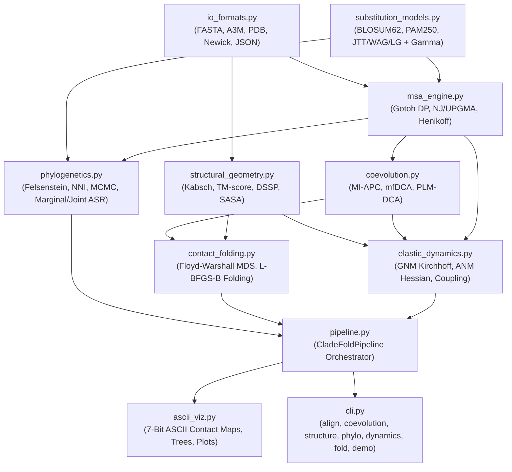
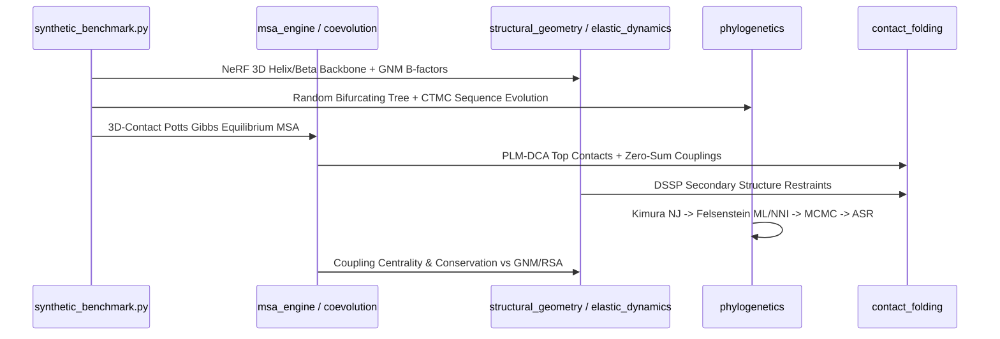

# CladeFold

[](https://github.com/ZengLLQ/clade-fold/actions/workflows/ci.yml)
[](https://www.python.org/downloads/)
[](LICENSE)
[](#overview)

**CladeFold** is a computational structural proteomics, co-evolutionary contact inference, elastic normal-mode dynamics, and Bayesian phylogenetic reconstruction suite implemented purely in Python, NumPy, and SciPy. It couples evolutionary sequence analysis directly to 3D protein geometry, folding energetics, and collective structural dynamics inside a single deterministic, headless, 7-bit ASCII-visualized framework.

---

## Overview

Modern protein family evolution couples residue conservation and epistatic pairwise substitutions across clades with three-dimensional fold stability and collective functional motions. **CladeFold** integrates six core biophysical and statistical engines:

1. **Progressive & Iterative Multiple Sequence Alignment (`msa_engine`)**: Pairwise $k$-mer Jaccard/Kimura evolutionary distances, Neighbor-Joining and UPGMA guide trees, Gotoh $O(L_1 L_2)$ affine-gap profile-profile dynamic programming with Henikoff sequence weights, and leave-one-out sum-of-pairs iterative refinement.
2. **Continuous-Time Markov Substitution Models (`substitution_models`)**: Exact BLOSUM62 and PAM250 log-odds matrices plus spectrally decomposed time-reversible CTMC models (**JTT**, **WAG**, **LG**) with Yang discrete $\Gamma_K$ rate heterogeneity and analytical transition derivatives.
3. **Evolutionary Co-Variation & Direct Coupling Analysis (`coevolution`)**: Homology-cluster sequence reweighting ($M_{\text{eff}}$), Mutual Information with Average Product Correction (**MI-APC**), Mean-Field DCA (**mfDCA**), and Pseudolikelihood Maximization Potts inference (**PLM-DCA**) via analytical L-BFGS-B optimization, zero-sum Ising gauge projection, and 3D contact Precision@L/5/L/AUROC benchmarking.
4. **3D Structural Geometry & Biophysics (`structural_geometry`)**: Kabsch $SO(3)$ rigid-body superposition ($\det R = +1$), Zhang-Skolnick TM-score and GDT-TS, backbone $(\phi, \psi, \omega)$ dihedrals with 2D Gaussian-mixture Ramachandran scoring, Kabsch-Sander electrostatic H-bond DSSP assignment, and Golden-Spiral Shrake-Rupley SASA/RSA and Eisenberg solvation free energy.
5. **Felsenstein Phylogenetics, Bayesian MCMC & ASR (`phylogenetics`)**: Log-rescaled Felsenstein postorder pruning under $\Gamma_K$ rate heterogeneity, Brent coordinate ML branch-length optimization, Nearest-Neighbor Interchange (NNI) topology search, Metropolis-Hastings Bayesian MCMC with ESS and Pulley-invariant bipartition posterior support, Robinson-Foulds distances, and Marginal Empirical-Bayes + Joint Pupko Ancestral Sequence Reconstruction.
6. **Elastic Network Dynamics & Contact-Restrained Folding (`elastic_dynamics`, `contact_folding`)**: Gaussian Network Model (GNM) Kirchhoff flexibility, hinge detection, Anisotropic Network Model (ANM) $3N \times 3N$ Hessian normal modes, apo-holo deformation overlap, Spearman evolution-dynamics coupling, and Torgerson MDS + L-BFGS-B 3D $C_\alpha$ folding with right-handed helix chirality restraints.

---

## System Architecture



### Coupled Benchmark & Verification Flow



---

## Mathematical Formulations

### 1. Time-Reversible CTMC Substitution & Discrete Gamma Rates

Each empirical amino-acid model (**JTT**, **WAG**, **LG**) defines a symmetric exchangeability matrix $S_{ij} = S_{ji} > 0$ and stationary equilibrium distribution $\boldsymbol{\pi} \in \Delta^{19}$ ($\sum_i \pi_i = 1$). The continuous-time rate generator $Q \in \mathbb{R}^{20 \times 20}$ is:

$$Q_{ij} = \mu S_{ij} \pi_j \quad (i \neq j), \qquad Q_{ii} = -\sum_{j \neq i} Q_{ij}, \qquad -\sum_{i=0}^{19} \pi_i Q_{ii} = 1$$

To compute exact matrix exponentials across arbitrary branch lengths $t \ge 0$ without complex roundoff, $Q$ is similarity-transformed into a real symmetric matrix $B$:

$$B = \Pi^{1/2} Q \Pi^{-1/2} = V \Lambda V^T, \qquad P(t) = \exp(Qt) = \Pi^{-1/2} V \exp(\Lambda t) V^T \Pi^{1/2}$$

Analytical branch derivatives follow immediately as $\frac{dP}{dt} = \Pi^{-1/2} V \left(\Lambda \odot \exp(\Lambda t)\right) V^T \Pi^{1/2}$. Site-to-site rate heterogeneity is modeled via Yang's $K$-category discrete $\Gamma(\alpha, \alpha)$ approximation with bin means:

$$r_k = K \left[ P\left(\alpha + 1,\; \alpha q_k\right) - P\left(\alpha + 1,\; \alpha q_{k-1}\right) \right], \qquad \frac{1}{K} \sum_{k=0}^{K-1} r_k = 1$$

where $P(s, x)$ is the regularized lower incomplete gamma function and $q_k$ are exact $\Gamma(\alpha, \alpha)$ quantiles.

### 2. Progressive Gotoh Profile-Profile Alignment & Henikoff Weights

Given a Neighbor-Joining or UPGMA guide tree, child profiles $(A, B)$ with Henikoff position-based sequence weights $w_m$ and non-gap occupancy $g_i^{(A)}, g_j^{(B)}$ are aligned under affine gap penalties $(g_{\text{open}}, g_{\text{extend}})$ via three dynamic programming recurrences ($M, I_x, I_y$):

$$M_{i,j} = \max\left(M_{i-1,j-1},\; I_{x,i-1,j-1},\; I_{y,i-1,j-1}\right) + g_i^{(A)} g_j^{(B)} \mathbf{f}_i^{(A)T} S_{\text{sub}} \mathbf{f}_j^{(B)}$$

### 3. Evolutionary Co-Variation: MI-APC, mfDCA, and PLM-DCA

Sequences are reweighted by homology clustering at identity threshold $\theta$ ($w_m = \left|\{n : \text{id}(m, n) \ge \theta\}\right|^{-1}$, $M_{\text{eff}} = \sum_m w_m$).

- **MI-APC**: Weighted Mutual Information $I_{ij} = \sum_{a,b<20} f_{ij}(a,b) \ln \frac{f_{ij}(a,b)}{f_i(a)f_j(b)}$ corrected by Average Product Correction:
  $$\text{APC}_{ij} = M_{ij} - \frac{\bar{M}_i \bar{M}_j}{\bar{M}}$$
- **mfDCA**: Regularized inversion of the connected $(20L) \times (20L)$ covariance $C_{ij}(a,b) = f_{ij}(a,b) - f_i(a)f_j(b)$, setting $e_{ij} = -\left((C + \lambda I)^{-1}\right)_{ij}$.
- **PLM-DCA**: Maximizes the conditional Potts pseudolikelihood independently at each column $i \in \{0, \dots, L-1\}$ using exact analytical gradients in L-BFGS-B:
  $$\mathcal{L}_i(h_i, J_{i,\cdot}) = -\frac{1}{M_{\text{eff}}} \sum_{m=1}^N w_m \ln \frac{\exp\left(h_i(a_i^{(m)}) + \sum_{j \neq i} J_{ij}(a_i^{(m)}, a_j^{(m)})\right)}{\sum_{c=0}^{20} \exp\left(h_i(c) + \sum_{j \neq i} J_{ij}(c, a_j^{(m)})\right)} + \lambda_h \|h_i\|_2^2 + \lambda_J \sum_{j \neq i} \|J_{ij}\|_F^2$$

Symmetrized couplings $\tilde{J}_{ij} = \frac{1}{2}(J_{ij} + J_{ji}^T)$ are projected onto the canonical 20-amino-acid **zero-sum (Ising) gauge**:

$$J'_{ij}(a, b) = \tilde{J}_{ij}(a, b) - \bar{J}_{ij}(\cdot, b) - \bar{J}_{ij}(a, \cdot) + \bar{J}_{ij}(\cdot, \cdot)$$

scored by Frobenius norm $\|J'_{ij}\|_F$ followed by APC.

### 4. Felsenstein Pruning, Bayesian MCMC, and Ancestral Sequence Reconstruction

At internal tree node $u$ with children $v \in \mathcal{C}(u)$ and discrete rate $r_k$, conditional likelihoods propagate postorder with per-node log-scaling $c_u(k, s)$ to eliminate IEEE-754 underflow:

$$L_u(k, s, a) = \exp\left(-c_u(k, s)\right) \prod_{v \in \mathcal{C}(u)} \sum_{b=0}^{19} P_{ab}(r_k t_v) L_v(k, s, b)$$

$$\ln \mathcal{L}(T, \boldsymbol{t}, \alpha) = \sum_{s=1}^L \operatorname{logsumexp}_{k=0}^{K-1} \left( \ln\left(\frac{1}{K} \sum_{a=0}^{19} \pi_a L_{\text{root}}(k, s, a)\right) + \sum_{u} c_u(k, s) \right)$$

Metropolis-Hastings Bayesian sampling proposes log-normal branch multipliers $t' = t e^{\sigma \varepsilon}$ (with Hastings Jacobian term $\ln(t'/t)$), Gamma shape $\alpha$ moves, and symmetric NNI topology swaps, recording Pulley-invariant unrooted bipartition posterior probabilities. Marginal ASR computes exact empirical-Bayes node posteriors $P(X_u = a \mid \text{MSA}, T) \propto L_u(a) U_u(a)$, while Joint ASR executes Pupko dynamic programming.

### 5. Structural Biophysics, Elastic Networks, and Contact-Restrained Folding

- **Kabsch & TM-score**: Solves $\min_{R \in SO(3), \mathbf{t}} \|\mathbf{X}_{\text{mob}} R^T + \mathbf{t} - \mathbf{X}_{\text{tgt}}\|_F^2$ with $\det(R) = +1$, and evaluates Zhang-Skolnick $\text{TM-score} = \max_{R, \mathbf{t}} \frac{1}{L} \sum_{i=1}^L \left(1 + (d_i / d_0(L))^2\right)^{-1}$.
- **DSSP Backbone H-Bonds**: Places virtual amide protons $\mathbf{H}_i$ and evaluates $E_{\text{HB}} = 27.888\left(\frac{1}{r_{ON}} + \frac{1}{r_{CH}} - \frac{1}{r_{OH}} - \frac{1}{r_{CN}}\right) < -0.5\text{ kcal/mol}$.
- **Shrake-Rupley SASA**: Golden-Spiral unit sphere quadrature ($N_{\text{pts}} = 92$ default) over probe-expanded $(N, C_\alpha, C, O, C_\beta)$ steric spheres.
- **GNM / ANM**: Kirchhoff Laplacian $\Gamma$ ($r_c = 7.0\,\text{\AA}$) yields theoretical B-factors $B_i \propto [\Gamma^+]_{ii}$; $3N \times 3N$ Hessian $H$ ($r_c = 13.0\,\text{\AA}$) has 6 exact rigid-body zero modes, giving fluctuation covariance $C = H^+$, cross-correlations $C_{ij}^{\text{ANM}} \in [-1, 1]$, and Bruschweiler mode collectivity $\kappa_m$.
- **Contact-Restrained Folding**: Initializes $C_\alpha$ coordinates via Floyd-Warshall + Torgerson MDS embedding, then minimizes flat-bottom bond, DSSP secondary-structure, DCA contact, steric clash, and right-handed $\alpha$-helix chiral scalar-triple-product potentials $\left((\mathbf{r}_{i,i+1} \times \mathbf{r}_{i+1,i+2}) \cdot \mathbf{r}_{i+2,i+3} \ge 20\,\text{\AA}^3\right)$.

---

## Module Map

| Module | Key Classes & Functions | Responsibility |
| --- | --- | --- |
| `src/clade_fold/types.py` | `ProteinStructure`, `MultipleSequenceAlignment`, `TreeNode`, `PipelineReport` | Invariant-checked containers, AA biophysical tables, encoding |
| `src/clade_fold/io_formats.py` | `parse_fasta`, `parse_a3m`, `parse_pdb`, `parse_newick`, `compute_virtual_cb` | Pure-Python scientific parsers, writers, SHA-256 digests |
| `src/clade_fold/substitution_models.py` | `BLOSUM62_MATRIX`, `PAM250_MATRIX`, `SubstitutionModel`, `discrete_gamma_rates` | Spectral CTMC (`JTT`, `WAG`, `LG`), derivatives, discrete Gamma |
| `src/clade_fold/msa_engine.py` | `build_progressive_msa`, `align_pairwise_gotoh`, `neighbor_joining`, `upgma_tree` | Affine-gap profile DP, Henikoff weights, refinement, entropy |
| `src/clade_fold/coevolution.py` | `compute_mi_apc`, `compute_mfdca`, `compute_plmdca`, `evaluate_contact_predictions` | Potts L-BFGS-B inference, zero-sum gauge, APC, AUROC/P@L |
| `src/clade_fold/structural_geometry.py` | `kabsch_superpose`, `compute_tm_score`, `assign_dssp_secondary_structure`, `compute_shrake_rupley_sasa` | 3D alignment, Ramachandran GMM, DSSP H-bonds, Golden-Spiral SASA |
| `src/clade_fold/phylogenetics.py` | `felsenstein_log_likelihood`, `search_topology_nni`, `run_bayesian_mcmc`, `reconstruct_ancestral_sequences` | Log-rescaled pruning, NNI, MH-MCMC, bipartition supports, ASR |
| `src/clade_fold/elastic_dynamics.py` | `run_elastic_network_analysis`, `compute_deformation_overlap`, `analyze_evolution_dynamics_coupling` | GNM B-factors, hinge detection, ANM 3N covariance, Spearman coupling |
| `src/clade_fold/contact_folding.py` | `mds_distance_embedding`, `reconstruct_ca_fold`, `FoldingConfig` | Distance-geometry MDS & chiral L-BFGS-B 3D folding |
| `src/clade_fold/synthetic_benchmark.py` | `generate_helical_hairpin_fold`, `generate_beta_hairpin_fold`, `simulate_potts_msa`, `simulate_tree_evolution` | NeRF peptide builder & coupled Potts/CTMC synthetic suite |
| `src/clade_fold/ascii_viz.py` | `render_contact_map_ascii`, `render_tree_ascii`, `render_ramachandran_ascii`, `render_dynamics_profile_ascii` | Pure 7-bit ASCII terminal plots and alignment views |
| `src/clade_fold/pipeline.py` | `CladeFoldPipeline`, `PipelineBundle`, `build_kimura_nj_tree` | End-to-end multi-subsystem orchestration & JSON telemetry |
| `src/clade_fold/cli.py` | `main`, `build_parser` | 7-subcommand CLI (`align`, `coevolution`, `structure`, `phylo`, `dynamics`, `fold`, `demo`) |

---

## Installation & Quick Start

```bash
git clone https://github.com/ZengLLQ/clade-fold.git
cd clade-fold
pip install -e .[dev]
```

### CLI Reference

| Subcommand | Purpose | Example |
| --- | --- | --- |
| `cladefold align` | Progressive/iterative Gotoh MSA | `cladefold align --input seqs.fasta --output aln.fasta --matrix BLOSUM62` |
| `cladefold coevolution` | MI-APC / mfDCA / PLM-DCA contacts | `cladefold coevolution --msa aln.a3m --pdb ref.pdb --method plmdca` |
| `cladefold structure` | DSSP, SASA, Ramachandran & TM-score | `cladefold structure --pdb model.pdb --reference-pdb native.pdb` |
| `cladefold phylo` | Felsenstein ML, NNI, MCMC & ASR | `cladefold phylo --msa aln.fasta --model WAG --mcmc-steps 200` |
| `cladefold dynamics` | GNM & ANM normal-mode flexibility | `cladefold dynamics --pdb model.pdb --gnm-cutoff 7.0 --anm-cutoff 13.0` |
| `cladefold fold` | Contact-restrained 3D $C_\alpha$ folding | `cladefold fold --msa aln.fasta --pdb template.pdb --fold-maxiter 180` |
| `cladefold demo` | Full coupled synthetic benchmark | `cladefold demo --length 32 --n-taxa 8 --n-coev 100 --mcmc-steps 60` |

### Python SDK Walkthrough

```python
from clade_fold import (
    CladeFoldPipeline,
    CoevolutionConfig,
    PhyloConfig,
    generate_coupled_benchmark,
)

suite = generate_coupled_benchmark(length=32, n_taxa=8, n_coev_seqs=120, seed=42)
pipeline = CladeFoldPipeline(
    coev_config=CoevolutionConfig(plm_maxiter=40),
    phylo_config=PhyloConfig(model_name="WAG", mcmc_steps=100, seed=42),
)
bundle = pipeline.run(
    project_name="HelixBundle_Demo",
    structure=suite.structure,
    phylo_msa=suite.phylo_msa,
    coev_msa=suite.coev_msa,
)
print(bundle.ascii_dashboard)
print(bundle.to_dict())
```

---

## Verified Benchmarks & Sample 7-Bit ASCII Output

Measured directly on the coupled synthetic benchmark (`examples/01..04` and `cladefold demo --n-taxa 8 --length 32 --mcmc-steps 60 --plm-maxiter 20 --seed 7`):

| Metric / Invariant | Observed Value | Subsystem |
| --- | --- | --- |
| CTMC Detailed Balance Residual (JTT / WAG / LG) | `1.73e-18` / `1.73e-18` / `3.47e-18` | `substitution_models` |
| CTMC Transition Matrix Row-Sum Error | `2.22e-16` | `substitution_models` |
| Kabsch $SO(3)$ Rigid Rotation RMSD / TM-score | `6.83e-15 A` / `1.000000` | `structural_geometry` |
| Co-Evolutionary 3D Contact AUROC (`L=28, N=220`) | `0.787` (PLM-DCA) / `0.806` (mfDCA) / `0.957` (MI-APC) | `coevolution` |
| Co-Evolutionary 3D Contact AUROC (`demo L=32, N=100`) | `0.801` | `pipeline` |
| Robinson-Foulds Distance vs Ground-Truth Tree | `0` (`normalized = 0.000`) | `phylogenetics` |
| Marginal & Joint ASR Posterior Confidence | `0.951` (`examples/03`) / `0.974` (`demo`) | `phylogenetics` |
| GNM Theoretical vs Synthetic Crystallographic B-factor $r$ | `1.000` | `elastic_dynamics` |
| Contact-Restrained Folding Helix Handedness / Clash Energy | `+62.0 deg` / `0.00` | `contact_folding` |

### Sample 7-Bit ASCII Terminal Output

```text
MSA View (8 seqs, 32 cols; showing 8)
[1..32]
  Taxon_4  IAALNSNMSNLLMHWIPVPRASVGRTLDRTGE
  Taxon_1  IANFNSNLSNLLMKQIPPRQMSVGVTLKTTGE
  Taxon_0  IADFNSNLSNLLVGPIPPRQMSVGRTLKTTGE
  Taxon_7  IADFNSFLSNLLVNPIPPRQMSVGRTLKTTGE
  Taxon_5  IADGSSWMSNLLMSPIALKQALVGRTLDRTGS
  Taxon_2  IADGSSNFSNLLLLPIPIKQAQVGRTLDRTGS
  Taxon_3  IADGSSNLSNLLILPIPIKQAQVERTMDKTGS
  Taxon_6  IADGSSNMKELLILPIPIKQAQVGRTIDRTGS
  Consensus  IADGNSNLSNLLMLPIPIKQASVGRTLDRTGE
  Conservation  **:::*::****..:**.:*::****:::**:
  DSSP_SS  CHHHHHHHHHHHHCCCCCHHHHHHHHHHHHHC

Phylogenetic Tree (branch_length | support):
clade
|-- clade (t=0.0563) [pp=1.00]
|   |-- clade (t=0.2243) [pp=1.00]
|   |   |-- Taxon_0 (t=0.2112)
|   |   `-- clade (t=0.3094) [pp=1.00]
|   |       |-- Taxon_5 (t=0.1297)
|   |       `-- Taxon_7 (t=0.1458)
|   `-- clade (t=0.0158) [pp=1.00]
|       |-- Taxon_4 (t=0.0693)
|       `-- clade (t=0.2177) [pp=1.00]
|           |-- Taxon_2 (t=0.1150)
|           `-- Taxon_6 (t=0.2250)
`-- clade (t=0.3667) [pp=1.00]
    |-- Taxon_1 (t=0.0007)
    `-- Taxon_3 (t=0.3337)

GNM Flexibility Profile (L=32, min=19.91, max=54.11, '^'=hinge)
 54.1 |#                               |
 49.2 |#                              #|
 44.3 |##                            ##|
 39.5 |####                        ####|
 34.6 |######                    ######|
 29.7 |#########   #  #   #   #########|
 24.8 |########## ##### #### ##########|
 19.9 |################################|
      +--------------------------------+
Hinge                ^^^^^
```

---

## Testing & Verification

```bash
python -m compileall src
flake8 src tests examples
mypy src
python -m pytest -v
python examples/01_msa_and_coevolution.py
python examples/02_structure_geometry_and_dssp.py
python examples/03_phylogenetics_ml_mcmc_asr.py
python examples/04_elastic_dynamics_and_coupling.py
```

---

## Trade-Offs, Assumptions & Known Limitations

- **Pure-Python / NumPy / SciPy Vectorization**: PLM-DCA and Felsenstein pruning avoid C/CUDA extensions for zero-blocker cross-platform installation (`ubuntu-latest`, `macos-latest`, `windows-latest` on Python 3.11/3.12). Consequently, PLM-DCA scales quadratically in site count $O(L^2 Q^2)$ per column optimization and is best suited for single domains ($L \lesssim 150$) rather than multi-thousand-residue assemblies without sub-sampling.
- **Coarse-Grained Sidechain SASA & Virtual $C_\beta$**: Shrake-Rupley SASA models each residue using its 4 backbone heavy atoms $(N, C_\alpha, C, O)$ plus a residue-specific effective $C_\beta$ steric sphere rather than full rotameric sidechain atoms, providing fast, rotationally invariant RSA estimates at ~5–10% approximation relative to all-atom crystallographic SASA.
- **Empirical Rate Matrices & Reversible Phylogeny**: JTT, WAG, and LG generators use calibrated biochemical exchangeability approximations satisfying exact detailed balance and unit mean substitution rate. Because reversible CTMCs satisfy Felsenstein's Pulley Principle, root placement is unidentifiable from likelihood alone; Bayesian posterior supports are therefore computed over unrooted bipartition splits.
- **Contact-Restrained $C_\alpha$ Folding Scope**: `reconstruct_ca_fold` uses distance-geometry MDS plus L-BFGS-B over harmonic contact/SS/chiral restraints rather than an all-atom force field or deep neural torsion predictor; it reconstructs coarse fold topology and right-handed helix chirality rather than atomic sidechain packing.
- **Research Scope Disclaimer**: CladeFold is a computational structural bioinformatics and evolutionary modeling tool for research and educational workflows, not a validated clinical or diagnostic medical device.
